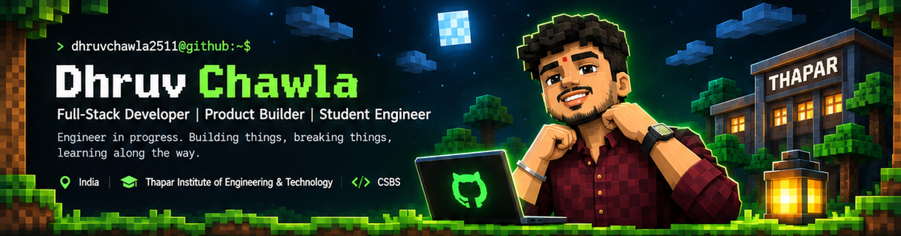
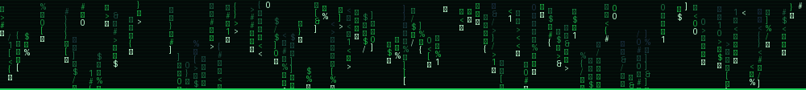

  

  

<h1 align="center">Hey, I'm Dhruv Chawla 👋</h1>

  <b>CSBS Student · Developer · Product Builder</b> 
  Thapar Institute of Engineering & Technology · India

  <a href="https://github.com/dhruvchawla2511">GitHub</a> &nbsp;•&nbsp;
  <a href="https://www.linkedin.com/in/dhruv-chawla-a7041641a/">LinkedIn</a> &nbsp;•&nbsp;
  <a href="mailto:dhruvchawla2511@gmail.com">Email</a>

---

<table>
  <tr>
    <td width="34%" valign="top">
      <h3>🧑‍💻 whoami</h3>
      I'm Dhruv, a Computer Science and Business Systems student who enjoys learning by building. I'm interested in software engineering, AI, systems, and turning ideas into useful products.
        
      <b>Current mode:</b> Build · Learn · Experiment
       
      <b>Based in:</b> India
    </td>
    <td width="66%" valign="top">
      <h3>⌨️ current_focus</h3>
      <pre><code>&gt; strengthening C and DSA fundamentals
&gt; building full-stack applications
&gt; exploring AI-powered products and agents
&gt; learning Linux, tools, and system workflows
&gt; shipping projects and improving through feedback</code></pre>
    </td>
  </tr>
</table>

## 🧩 The build loop

<table>
  <tr>
    <td align="center" width="25%"><h3>🧱 Build</h3>Projects & products</td>
    <td align="center" width="25%"><h3>📚 Learn</h3>New tools & concepts</td>
    <td align="center" width="25%"><h3>🏆 Compete</h3>Hackathons & case comps</td>
    <td align="center" width="25%"><h3>🚀 Grow</h3>Engineer & builder</td>
  </tr>
</table>

## 🛠️ Tech stack & toolbox

  
  
  
  

  
  
  
  

  
  
  
  
  

  
  

These are technologies and tools I've worked with or explored. I'm continuing to build depth rather than claiming expert-level proficiency across the stack.

## 🚀 Featured projects

<table>
  <tr>
    <td width="15%" align="center"><h1>🏫</h1></td>
    <td>
      <h3>UniLink</h3>
      A student-focused platform concept for connecting, collaborating, and sharing useful resources within a university community.
       React · TypeScript · Node.js
       <b>Repository:</b> <i>Add repository URL</i>
    </td>
  </tr>
  <tr>
    <td align="center"><h1>🌦️</h1></td>
    <td>
      <h3>WeatherGPT · SIH</h3>
      A weather-focused project developed in the Smart India Hackathon context, exploring ways to make weather information more useful and actionable.
       Project technology stack to be confirmed
       <b>Repository:</b> <i>Add repository URL</i>
    </td>
  </tr>
  <tr>
    <td align="center"><h1>🧊</h1></td>
    <td>
      <h3>MultiSim</h3>
      A software project exploring simulation and modelling.
       Technology stack and project description to be confirmed
       <b>Repository:</b> <i>Add repository URL</i>
    </td>
  </tr>
</table>

## 🏆 Build log / activities

- Participated in a 24-hour hackathon at IIT Delhi.
- Took part in the Smart India Hackathon journey with a college team.
- Participated in case competitions and collaborative project work.
- Enjoy building with teams, learning unfamiliar tools, and solving practical problems.

## 📖 Currently learning

- Data Structures & Algorithms
- Stronger C programming fundamentals
- Full-stack application development
- AI agents and practical AI applications
- Software design and systems fundamentals

## 🧠 Interests

`AI & LLMs` · `Product Development` · `Software Engineering` · `Linux & Systems` · `Startups` · `Problem Solving`

## 📊 GitHub telemetry

  
  

  

## 🤝 Connect

  
  
  

  <i>Learning by building. Improving one commit at a time. ⛏️</i>

